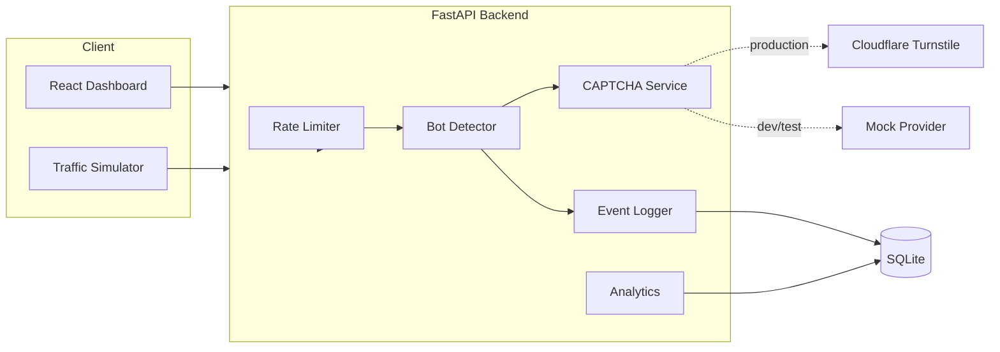

# BotShield Lab

**Open-source anti-bot testing platform for local defensive demonstrations.**

BotShield Lab shows how a web application can detect suspicious automated traffic, enforce rate limits, validate CAPTCHA challenges, and monitor request activity — all in a controlled environment you run yourself.

> **Not a production WAF.** This project is an educational portfolio demo. Do not expose it to the public Internet without a security review. See [docs/SECURITY.md](docs/SECURITY.md).


---

## Problem statement

Automated clients can overwhelm forms, scrape content, and abuse public APIs. Real bot management systems are complex and opaque. Developers need a **transparent, local sandbox** to learn how rate limiting, explainable heuristics, CAPTCHA verification, and request analytics fit together — without attacking third-party sites or shipping blind “AI detection” claims.

BotShield Lab provides that sandbox.

## Features

| Feature | Description |
| --- | --- |
| **Request monitoring dashboard** | Live totals, activity chart, recent events, filters — backed by SQLite, not hardcoded stats |
| **Configurable rate limiting** | Env-driven limits, HTTP 429 + headers, violations logged; memory or Redis storage |
| **Explainable bot detection** | Rule-based risk scores (0–100) with human-readable reasons and false-positive safeguards |
| **CAPTCHA (Turnstile + mock)** | Server-side verification only; mock provider for offline tests; blocked in production |
| **Controlled traffic simulator** | Local-only bursts/repeats with caps, cancel, and result counts |
| **Event history API** | Paginated, filterable, sanitized request events |
| **OpenAPI docs** | FastAPI Swagger UI at `/docs` |

## Architecture



## Technology stack

**Backend:** Python 3.12+, FastAPI, Pydantic, SQLAlchemy, SQLite, custom sliding-window rate limiter with optional Redis backend, Pytest, HTTPX  

**Frontend:** React, TypeScript, Vite, Tailwind CSS, Recharts, Lucide, Axios  

**Infra:** Docker, Docker Compose, GitHub Actions, `.env` configuration  

## Screenshots

Add genuine captures under [`docs/screenshots/`](docs/screenshots/) after running the app:

1. Overview dashboard with metrics and chart  
2. Events table with detection details  
3. Simulator results  
4. Detection / CAPTCHA configuration pages  

```markdown

```

## Quick start

### Prerequisites

- Python 3.12+
- Node.js 20+ (22 recommended)
- Docker & Docker Compose (optional)
- Git

### 1) Clone and configure

```bash
git clone <your-repo-url> Anti-Bot-Testing
cd Anti-Bot-Testing
cp .env.example .env
```

### 2) Development workflow (recommended while coding)

**Backend**

```bash
cd backend
python -m venv .venv

# Windows PowerShell
.\.venv\Scripts\Activate.ps1

# macOS / Linux
# source .venv/bin/activate

pip install -r requirements.txt
uvicorn app.main:app --reload --host 127.0.0.1 --port 8000
```

API: http://127.0.0.1:8000  
Swagger: http://127.0.0.1:8000/docs  

**Frontend** (new terminal)

```bash
cd frontend
npm install
npm run dev
```

UI: http://127.0.0.1:5173 (Vite proxies `/api` to the backend)

### 3) Docker Compose workflow

```bash
cp .env.example .env
docker compose up --build
```

- UI: http://127.0.0.1:8080  
- API: http://127.0.0.1:8000  
- Docs: http://127.0.0.1:8000/docs  

## Environment variables

See [`.env.example`](.env.example) for the full reference. Important groups:

| Variable | Purpose | Default (demo) |
| --- | --- | --- |
| `RATE_LIMIT_REQUESTS` / `RATE_LIMIT_WINDOW_SECONDS` | Demo endpoint budget | `10` / `60` |
| `RATE_LIMIT_STORAGE` | `memory` or `redis` | `memory` |
| `DETECTION_*` | Scoring thresholds | see `.env.example` |
| `CAPTCHA_ENABLED` / `CAPTCHA_PROVIDER` | `mock` or `turnstile` | mock in development |
| `TURNSTILE_SITE_KEY` / `TURNSTILE_SECRET_KEY` | Cloudflare credentials | empty |
| `TRUST_FORWARDED_HEADERS` / `TRUSTED_PROXY_IPS` | Proxy trust | off / empty |
| `SIMULATION_MAX_REQUESTS` | Hard cap for simulator | `50` |
| `CORS_ORIGINS` | Allowed browser origins | localhost Vite |

**Never commit real secrets.** The secret key must exist only on the backend.

## CAPTCHA setup

### Local mock (default for development & CI)

```env
CAPTCHA_ENABLED=true
CAPTCHA_PROVIDER=mock
CAPTCHA_MOCK_ENABLED=true
CAPTCHA_MOCK_VALID_TOKEN=mock-valid-token
```

Use token `mock-valid-token` in the CAPTCHA page or API. Mock verification is **rejected** when `APP_ENV=production`.

### Cloudflare Turnstile

1. Create a widget in the [Cloudflare Turnstile dashboard](https://developers.cloudflare.com/turnstile/).  
2. Set:

```env
CAPTCHA_ENABLED=true
CAPTCHA_PROVIDER=turnstile
TURNSTILE_SITE_KEY=your_site_key
TURNSTILE_SECRET_KEY=your_secret_key
```

3. Verification is always performed **server-side**. Client-side widget success is never treated as proof.

## API examples

```bash
# Health
curl http://127.0.0.1:8000/api/v1/health

# Protected demo
curl -X POST http://127.0.0.1:8000/api/v1/demo/protected \
  -H "Content-Type: application/json" \
  -H "User-Agent: Mozilla/5.0" \
  -d '{"message":"hello","captcha_token":"mock-valid-token"}'

# Dashboard metrics
curl http://127.0.0.1:8000/api/v1/analytics/dashboard

# Events (filtered)
curl "http://127.0.0.1:8000/api/v1/events?outcome=rate_limited&page=1"

# Simulation (local only)
curl -X POST http://127.0.0.1:8000/api/v1/simulation/run \
  -H "Content-Type: application/json" \
  -d '{"mode":"normal","request_count":5,"interval_ms":200,"endpoint":"health"}'
```

Interactive docs: http://127.0.0.1:8000/docs  

## Testing

```bash
# Backend
cd backend
pip install -r requirements.txt
pytest -q
ruff check app tests

# Frontend
cd frontend
npm install
npm run lint
npm run typecheck
npm run test
npm run build
```

Tests use the mock CAPTCHA provider and do **not** require live external services.

## Threat model & security limitations

- **User-Agent detection alone does not reliably identify bots.** Weak UA signals contribute modest score and never auto-ban by themselves.
- **IP identity is imperfect**, especially behind proxies. Forwarded headers are trusted only when explicitly enabled and the peer is in `TRUSTED_PROXY_IPS`.
- **In-memory rate limits** do not synchronize across workers; use Redis for multi-process deployments.
- **SQLite** is for local demos.
- This demonstration is **not production-ready** without a security review.

Full write-up: [docs/SECURITY.md](docs/SECURITY.md)

## Privacy considerations

- Client identifiers are **hashed**; raw IPs are not stored in the event table.
- CAPTCHA tokens, passwords, cookies, and authorization headers are **not** persisted.
- Event logs intentionally omit unnecessary personal data.

## Known limitations

- Single-process cancel flag for simulations (adequate for local demos).
- Detection state is in-memory (resets on process restart).
- Turnstile widget embedding in the UI is optional; paste-token flow is provided for demos.
- No authentication on the dashboard (local lab assumption).

## Roadmap

- [ ] Optional authenticated lab mode  
- [ ] Prometheus metrics export  
- [ ] Additional detection rules with unit tests  
- [ ] Playwright smoke tests for the dashboard  
- [ ] Packaged Turnstile widget component when site key is present  

## Contributing

See [CONTRIBUTING.md](CONTRIBUTING.md). PRs that add offensive tooling (third-party targeting, CAPTCHA bypass, stealth automation) will be rejected.

## License

[MIT](LICENSE) © 2026 BotShield Lab contributors

## Troubleshooting

| Symptom | Likely fix |
| --- | --- |
| CORS errors in browser | Ensure `CORS_ORIGINS` includes your UI origin; restart backend |
| Rate limit never triggers | Lower `RATE_LIMIT_REQUESTS`; confirm you are hitting `/demo/protected` |
| Mock CAPTCHA always fails | Use exact token from `CAPTCHA_MOCK_VALID_TOKEN` |
| Simulation “host not allowed” | Only `127.0.0.1` / `localhost` (and Docker `backend`) are permitted |
| Frontend API 404 | Run backend on `:8000` or set `VITE_API_BASE_URL` |
| Redis storage errors | Use `RATE_LIMIT_STORAGE=memory` unless Redis is reachable |
